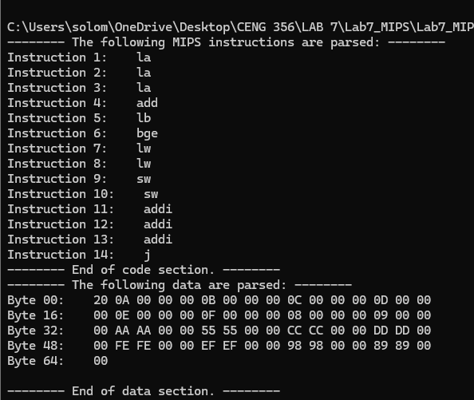
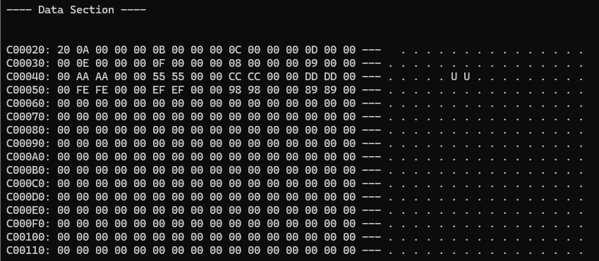
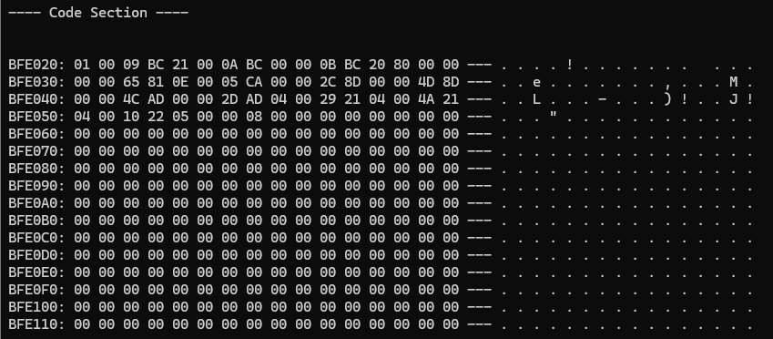

# CENG 356 - Lab 7: MIPS Architecture Design - Instruction Set

**Student:** Solomon Ewusi
**Student ID:** N01659373
**Course:** CENG 356 - Computer Systems Architecture
**Institution:** Humber College

---

## Overview

This lab simulates part of a MIPS computer in C. The program reads `MIPS.asm`, parses it into data and instructions, converts each instruction into **32-bit MIPS machine code**, and loads everything into a simulated 1 MB memory:
- **Code section** at offset `0x0000`
- **Data section** at offset `0x2000`

---

## Files

| File | Description |
|------|-------------|
| `lab7.c` | **Completed by me.** Machine-code builders, data/code loading, answers to all comment questions |
| `memory.c` | My Lab 6 memory code, updated for Lab 7 (memory filled with 0, added `write_byte()`) |
| `main.c`, `header.h`, `parser.c`, `parser.h` | Provided by the professor |
| `MIPS.asm` | The MIPS program used as input |
| `LAB 7 ONLINE REPORT - SOLOMON EWUSI.docx` | Lab report |
| `screenshots/` | Parser output and memory dumps of both sections |

---

## What I Completed in lab7.c

- **`setupDataMemory()`**: copies the parsed data bytes into memory starting at `0x2000`.
- **`buildRInstruction()`**: `000000ss sssttttt dddddaaa aaffffff`
- **`buildJInstruction()`**: `ooooooii iiiiiiii iiiiiiii iiiiiiii`
- **`setupInstructionMemory()`**: builds the machine code for **lb, bge, lw, sw, add, addi, j** (la was given as the example)

| Instruction | Type | Opcode / Function |
|---|---|---|
| la | I | 101111 |
| lb | I | 100000 |
| bge | I | 110010 (CENG356 special instruction) |
| lw | I | 100011 |
| sw | I | 101011 |
| add | R | opcode 000000, function 100000 |
| addi | I | 001000 |
| j | J | 000010 |

---

## Results

Machine code for the program (memory stores each word little-endian, so the dump shows the bytes in reverse):

| # | Instruction | Machine code |
|---|---|---|
| 1 | `la $t1, testdata1` | `BC090001` |
| 2 | `la $t2, testdata2` | `BC0A0021` |
| 3 | `la $t3, counter` | `BC0B0000` |
| 4 | `add $s0, $zero, $zero` | `00008020` |
| 5 | `lb $a1, 0($t3)` | `81650000` |
| 6 | `bge $s0, $a1, exit` | `CA05000E` |
| 7 | `lw $t4, 0($t1)` | `8D2C0000` |
| 8 | `lw $t5, 0($t2)` | `8D4D0000` |
| 9 | `sw $t4, 0($t2)` | `AD4C0000` |
| 10 | `sw $t5, 0($t1)` | `AD2D0000` |
| 11 | `addi $t1, $t1, 4` | `21290004` |
| 12 | `addi $t2, $t2, 4` | `214A0004` |
| 13 | `addi $s0, $s0, 4` | `22100004` |
| 14 | `j loop` | `08000005` |

### Parser output


### Data section (offset 0x2000)


### Code section (offset 0x0000)


---

## How to Compile and Run

Requires GCC (MinGW on Windows).

```bash
gcc -fcommon main.c lab7.c parser.c memory.c -o lab7.exe
lab7.exe MIPS.asm
```

`-fcommon` is needed with newer GCC versions because `header.h` defines global arrays that are included in several `.c` files. Press Enter when the program pauses to see the memory dumps.

---

## GitHub Repository
[https://github.com/SolomonEwusi9373/SolomonEwusiCENG356-Lab7](https://github.com/SolomonEwusi9373/SolomonEwusiCENG356-Lab7)
